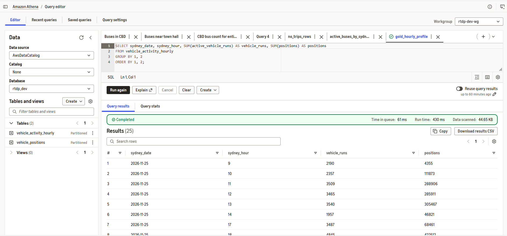
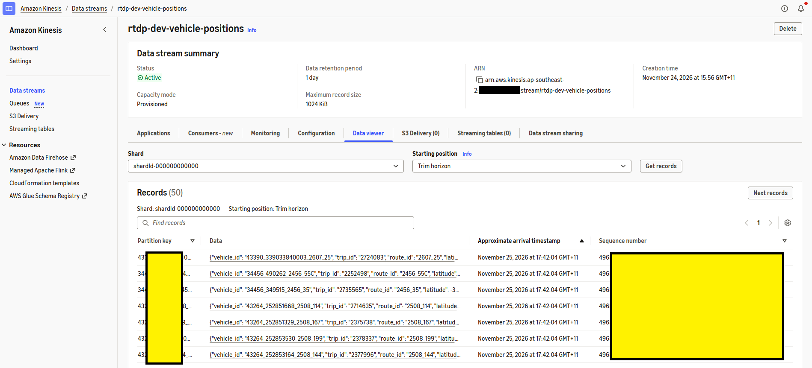
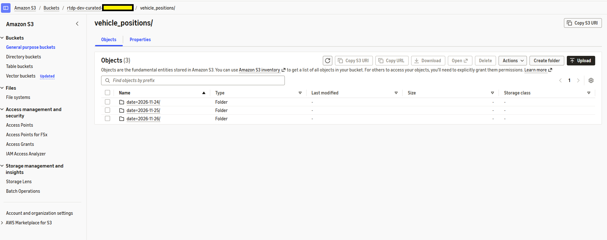
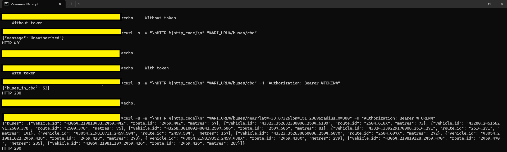

# AWS Realtime Data Platform

Streams live TfNSW bus positions (GTFS-realtime) into a medallion data platform on AWS and serves geospatial queries through a secured API. Built with Terraform; deployed through GitHub Actions using OIDC.

## Architecture

```
EventBridge (1 min, off by default)
  -> Producer Lambda (polls every ~15 s)
       -> S3 raw              [Bronze: original protobuf]
       -> Kinesis Data Stream (one JSON record per vehicle)
            -> Consumer Lambda -> S3 curated   [Silver: Parquet, UTC date/hour partitions]
                                     -> Glue PySpark job -> S3 gold  [Gold: Sydney-hourly route activity]
Glue Data Catalog (Silver, Gold) -> Athena
API Gateway (HTTP API, Cognito JWT) -> Query Lambda -> Athena
```

## Components

| Component | Purpose |
|---|---|
| Producer Lambda | Polls the TfNSW feed, skips unchanged snapshots, writes raw bytes to S3 and one record per vehicle to Kinesis, retrying only failed records |
| Kinesis Data Stream | 1 shard, 24 h retention, KMS-encrypted; partition key `vehicle_id` keeps each vehicle's events in order |
| Consumer Lambda | Batches records into Parquet by UTC hour; reports failed records individually (partial batch failure) |
| SQS dead-letter queue | Receives shard and sequence coordinates of records that exhaust retries, for replay |
| Glue job `gold-hourly` | PySpark: Silver to Gold, recomputing the last 3 days with dynamic partition overwrite |
| Glue Data Catalog | Explicit schemas with partition projection for Silver and Gold |
| Athena | SQL and geospatial queries; workgroup enforces a 1 GB scan limit per query |
| Cognito | OAuth 2.0 client-credentials tokens with scope `rtdp-api/read` |
| API Gateway (HTTP API) | JWT authorizer, scoped routes, throttling, access logs |
| Query Lambda | Fixed geospatial queries with validated, parameterised input |
| SSM Parameter Store | TfNSW API key as a SecureString; Terraform holds only a placeholder |
| IAM | One role per function, scoped to the resources it uses |

## Design decisions

| Decision | Reason |
|---|---|
| Parse in the producer, one record per vehicle | Real partition key, per-vehicle ordering, small records |
| Keep raw protobuf in S3 | Exact source copy for reprocessing |
| Kinesis Data Streams over Firehose | Control over processing; multiple consumers and replay |
| Partial batch failure, bisect, DLQ | A bad record never blocks the shard; failures are isolated and replayable |
| UTC in Silver, Sydney time in Gold | Storage stays unambiguous across daylight saving; conversion happens once, in the Glue job |
| Gold window recompute | Idempotent reruns; the earliest Sydney date in the window is dropped because the UTC partitions read only cover part of it |
| Partition projection over crawlers | Schema is known; no crawler runs or partition maintenance |
| HTTP API over REST API | Lower cost and latency, native JWT authorizer; REST features (usage plans, caching, WAF) not needed |
| Fixed queries, not raw SQL | Input is validated and passed as Athena execution parameters: no injection, no unbounded scans |
| Throttling (5 req/s, burst 10) | Caps cost even if a token leaks |
| API key loaded lazily | No AWS calls at import, so handlers are unit-testable offline |
| SSM SecureString over Secrets Manager | Static key, no rotation needed |
| GitHub OIDC deploy role | No long-lived AWS keys in CI |
| Separate bootstrap stack | State bucket and CI role survive teardown of the main stack |

## API

1. Request a token from the Cognito token endpoint with the client ID and secret (scope `rtdp-api/read`). Tokens are valid for 60 minutes.
2. Call the API with `Authorization: Bearer <token>`.

| Route | Description |
|---|---|
| `GET /buses/cbd` | Buses inside the Sydney CBD in the latest snapshot |
| `GET /buses/near?lat=&lon=&radius_m=` | Buses within a radius of a point (Sydney only, 50–2000 m, max 200 rows) |

| Status | When |
|---|---|
| 200 | Query succeeded |
| 400 | Invalid or missing parameters, or a point outside Sydney |
| 401 | Missing, invalid or expired token |
| 404 | Unknown route |
| 504 | Query exceeded the time limit; the query is stopped |

Sample response: `docs/sample_results/api_near_response.json`

## Testing

```
python -m pytest -q                  # unit tests, offline
python -m pytest -m integration -q   # live API; needs API_URL, TOKEN_URL, CLIENT_ID, CLIENT_SECRET
```

Unit tests cover parsing, UTC partitioning, partial batch failure, retry of failed Kinesis records, API validation (bad input never starts a query), routing and query timeouts. Integration tests check 401 without a token, 200 with a token and 400 validation through the gateway.

## Data notes

- `vehicle_id` embeds operator, run and route (`<operator>_<run>_<route>`), so distinct counts over time measure vehicle-runs rather than physical buses.
- Rows without a `trip_id` are rare (2 of ~116k on 2026-11-24 UTC); kept in Silver, excluded from Gold.
- Silver and Gold reconcile: Gold's 9:00 Sydney hour on 2026-11-25 has 4,355 positions against Silver's 4,357; the difference is the 2 rows without a trip.

## Findings (24-hour capture)

- Peak: __ vehicle-runs at __:00 Sydney time; overnight low of __ at __:00.
- Latest snapshot: __ buses inside the CBD; __ within 500 m of Town Hall.

Queries in `sql/`, results in `docs/sample_results/`.

## Repository layout

```
terraform/bootstrap   state bucket, GitHub OIDC provider, deploy role (local state)
terraform/main        platform resources (S3 remote state)
src/producer          producer Lambda
src/consumer          consumer Lambda
src/api               query Lambda
src/glue              Glue PySpark job
sql/                  Athena queries
tests/unit            offline unit tests
tests/integration     live API tests (opt-in)
docs/sample_results   query and API outputs
```

## Setup

1. `terraform/bootstrap`: copy `terraform.tfvars.example` to `terraform.tfvars`, then `terraform init` and `terraform apply`
2. `terraform/main`: create `backend.hcl` with `bucket = "<state-bucket>"`, then `terraform init -backend-config=backend.hcl`
3. Store the TfNSW key: `aws ssm put-parameter --name /rtdp/dev/tfnsw/api-key --type SecureString --value "<key>" --overwrite`
4. Local environment: `python -m venv .venv`, activate it, `pip install -r requirements-dev.txt`

## Screenshots

| | |
|---|---|
| Gold hourly profile in Athena |  |
| Records in Kinesis |  |
| Silver partitions in S3 |  |
| API: 401 without token, 200 with token |  |

## Build and deploy

The producer needs its dependencies vendored; the other functions and the Glue script are packaged by Terraform.

```
pip install -r src/producer/requirements.txt --platform manylinux2014_x86_64 --implementation cp --python-version 3.12 --only-binary=:all: --target build/producer
copy src\producer\handler.py build\producer\
terraform -chdir=terraform/main apply
```

## Run

- Producer once: `aws lambda invoke --function-name rtdp-dev-producer build/out.json`
- Producer on schedule: set `producer_schedule_enabled = true` in `terraform/main/terraform.tfvars` and apply; set it to `false` to stop
- Gold job: `aws glue start-job-run --job-name rtdp-dev-gold-hourly`

## Cost notes

- The Kinesis shard is billed per hour while the stream exists; the producer schedule is off by default
- A Gold job run costs a few cents (2 workers, about 2 minutes)
- Cognito charges per token request; API Gateway, Lambda and Athena charge per use

## Known limitations

- The deploy role uses AdministratorAccess; to be scoped down
- Single environment (`dev`)
- No private networking (VPC endpoints)
- Silver is written per micro-batch, so it has many small files; compaction belongs in the Gold job
- On the April daylight-saving change, Gold's `sydney_hour = 2` combines two real hours
- The Gold job runs on demand
- The Cognito client secret is stored in Terraform state, which is encrypted and private